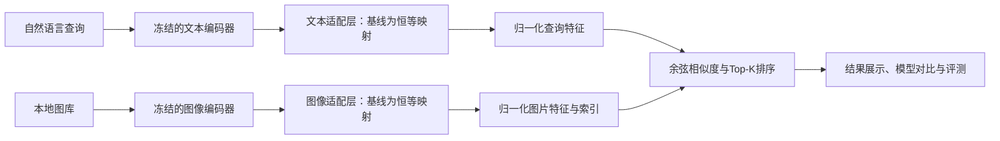

# 面向细粒度语义理解的自然语言图片检索系统

**Fine-Grained Natural Language Image Retrieval**

《自然语言处理技术》课程大作业。项目目标是构建一套**在本地运行、通过自然语言寻找图片**的多模态软件系统，研究轻量适配与困难负样本训练是否能改善颜色、数量、动作和空间关系等细节的检索表现。

> 当前状态：项目初始化与方案确定。已实现基础向量检索、评测工具和示例；尚未实现真实图文编码、模型训练和Web界面。仓库中的示例是人工构造的向量，不代表CLIP输出或真实检索效果。没有训练结果，也不预先承诺提升。

## 1. 项目要解决什么问题

传统关键词检索依赖人工标签，难以表达“穿红衣服的人在海边奔跑”这样的组合条件。预训练图文模型支持语义检索，但可能忽略颜色、数量、动作或关系中的关键区别。

本项目接收一段自然语言，从本地图库中返回Top-K图片，并支持比较原始模型与改进模型的排序结果。例如：

- `a person in a red shirt running on the beach`：同时关注人物、颜色、动作和场景。
- `a cat under a table`：区分桌子上方与下方。
- `two dogs playing on the grass`：区分主体数量和动作。

第一阶段使用与数据及模型匹配的英文查询完成闭环；中文支持作为条件允许时的扩展。中文不是通过外部翻译接口实现，需要选择本地中文图文模型并准备匹配的中文数据，单独评测。

## 2. 约束与范围

- 不调用外部AI推理、嵌入、翻译或重排序接口。
- 方案假定课程允许使用开源预训练模型：权重下载后在本地编码、训练和检索。应在开题时确认这一点；若禁止预训练权重，需要重新缩小题目和训练方案。
- 软件安装、数据准备、模型下载可以联网；部署时从本地路径加载模型，检索阶段可断网运行。
- 不从头训练大型CLIP模型，不将生成式问答或自动操作电脑作为本项目任务。
- 必做：真实图文检索基线、轻量训练、对比实验、可演示界面、书面报告。
- 三至四周版本增加：困难负样本训练、细粒度评测、失败案例分析。
- 可选：以图搜图、图库增量更新、中文版本、大规模近似索引。

## 3. 核心研究问题

1. 冻结图文编码器后，训练轻量适配层是否能改善目标数据集上的检索？
2. 困难负样本是否比普通批内负样本更有利于区分相似场景？
3. 改进在颜色、数量、动作和空间关系上是否一致？是否牺牲总体效果？
4. 缓存图片特征后，检索的延迟、索引大小和更新成本是多少？

## 4. 计划实现的功能

| 功能 | 输入与输出 | 优先级 |
| --- | --- | --- |
| 数据检查 | 图文清单 → 无效路径、重复ID、划分泄漏报告 | P0 |
| 图片特征提取 | 本地图片、模型目录 → 可复用的特征索引 | P0 |
| 文本搜图 | 自然语言 → 按相似度排序的Top-K图片 | P0 |
| 轻量适配训练 | 训练集特征 → 图文适配层与训练日志 | P0 |
| 自动评测 | 测试查询、相关图片标注 → Recall与排名指标 | P0 |
| 检索界面 | 查询、K、模型选择 → 图片与相似度 | P0 |
| 基线/改进并排比较 | 同一查询 → 两组结果与检索耗时 | P1 |
| 困难负样本挖掘 | 训练集检索候选 → 经筛选的负样本 | P1 |
| 分类型评测 | 细粒度测试标注 → 分类指标及错误案例 | P1 |
| 以图搜图、增量更新 | 新图片 → 相似图片或更新后的索引 | P2 |

相似度用于排序，不解释为匹配概率。不同模型的分数不直接当作统一置信度比较。

## 5. 技术路线



计划技术栈：Python 3.11、PyTorch、OpenCLIP、NumPy、Pillow、Streamlit。初版使用精确余弦检索，小图库无需引入向量数据库；只有规模和性能测量证明必要时再考虑FAISS。

模型候选为OpenCLIP支持的CLIP ViT-B/32。最终实现需固定模型名称、权重来源、版本及预处理方式，并在硬件上实测。编码器默认冻结，先缓存图文特征，再训练小型残差适配层，降低重复编码成本。

## 6. 数据与实验

起步候选数据集为Flickr8k；实施前确认获取方式、使用条款和划分。优先采用数据集官方划分并记录其来源。不得将同一图片的不同描述分到不同集合；近重复图片应共同划分。

| 实验 | 方法 | 作用 |
| --- | --- | --- |
| E0 | 原始预训练模型，不训练 | 建立可复现基线 |
| E1 | 冻结编码器＋残差适配层＋批内负样本 | 测量轻量训练的贡献 |
| E2 | E1＋经筛选的困难负样本 | 测量负样本策略的贡献 |
| E3 | 最终方案按细粒度类别分析 | 找出有效条件与失败模式 |

在同一候选图库和同一测试查询上比较Recall@1/5/10、MRR及查询延迟。测试集不参与挖掘、调参或早停。细粒度测试子集目标为80—120条，允许多标签和多个相关图片；其建立成本应计入项目工作量。

详细方案见[实验设计](docs/experiments.md)和[数据规范](docs/data.md)。

## 7. 当前代码能运行什么

以下命令只需要Python标准库，不下载模型、不调用网络：

```bash
python -m pip install -e .
python -m fgir search --index examples/index.json --query-vector examples/query_vector.json --top-k 3
python -m fgir evaluate --rankings examples/rankings.json --qrels examples/qrels.json
python -m unittest discover -s tests -v
```

首条命令安装项目命令模块，不安装未来训练栈。示例ID没有配套真实图片，不能作为图文系统演示。真实的图片导入、文本编码、训练与界面命令将在实现后补充，不提供无法运行的占位命令。

## 8. 仓库结构

```text
docs/                 项目方案、技术架构、数据、实验、计划与开题提纲
src/fgir/             已实现的向量检索、评测和命令行
configs/              计划配置，尚无配置读取器
examples/             人工构造的离线验证样例
tests/                检索与指标的边界验证
data/                 数据说明，不提交真实数据
models/               本地权重说明，不提交模型
artifacts/            生成索引与实验产物说明
.github/workflows/    核心代码自动检查
```

## 9. 进度与交付

开题时间：2026年10月22日或24日，以课程安排为准。完整开发周期为2—4周，四周计划目标至11月12日，具体提交日期以老师通知为准。

- 两周：数据、基线、轻量训练、基础界面、对比评测和报告。
- 三至四周：困难负样本、细粒度分析、模型对比界面、复现整理。
- 最终交付：代码、环境与运行说明、数据准备说明、实验配置及真实结果、系统演示、书面报告。

目前只有初始化版本，不将规划项标记为完成。具体任务见[开发计划](docs/roadmap.md)。

## 文档导航

- [详细项目方案](docs/project-plan.md)：背景、目标、模块与验收标准。
- [技术架构](docs/architecture.md)：编码器、适配层、损失与索引版本。
- [数据规范](docs/data.md)：数据格式、划分、负样本与标注。
- [实验设计](docs/experiments.md)：对比、指标、计时与结果模板。
- [开发计划](docs/roadmap.md)：2—4周里程碑与分工建议。
- [开题报告提纲](docs/proposal.md)：可直接用于准备开题汇报的内容。
- [开发协作说明](CONTRIBUTING.md)：提交和复现要求。

代码暂不附加开源许可证；第三方模型、数据的使用条款分别适用。成员、指导教师和最终数据集等信息由团队确认后填写。
