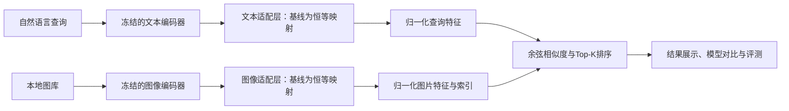

# 面向细粒度语义理解的自然语言图片检索系统

**Fine-Grained Natural Language Image Retrieval**

**D 展示入口：** 双击 `preview.cmd` 打开离线交互预览（示意图片与固定排名，非真实模型结果）。
真实检索运行 `install.cmd`、`start-demo.cmd`，详见[安装与接入说明](docs/demo.md)。
Windows 源码安装 ZIP 与 Python wheel 可运行 `python scripts/build-demo-package.py` 构建，
或在 GitHub Actions 的 **D demo package** 中下载构建产物。真实图片、权重与索引另行准备。

《自然语言处理技术》课程大作业。项目目标是构建一套**在本地运行、通过自然语言寻找图片**的多模态软件系统，研究轻量适配与困难负样本训练是否能改善颜色、数量、动作和空间关系等细节的检索表现。

> 当前状态：A的数据/评测、B的本地CLIP编码/缓存/负样本接口和C的残差适配/E1/E2训练/模型导出已实现。清洗版训练5998图，验证/测试各1000图。C的运行与交接见[训练说明](docs/training.md)。细粒度初标与预审明确披露AI辅助，独立复核仍待团队完成；Web界面由D接入。人工排名示例不代表模型效果。

**B/C/D从这里开始：[A交接手册](docs/handoff-a.md)。** 本地数据入口为`data/prepared/flickr8k-v1/`；其他电脑执行`python -m pip install -e ".[data]"`及`python -m fgir prepare-a-data`重建。图片、权重和完整生成产物不提交Git。

## 1. 项目要解决什么问题

传统关键词检索依赖人工标签，难以表达“穿红衣服的人在海边奔跑”这样的组合条件。预训练图文模型支持语义检索，但可能忽略颜色、数量、动作或关系中的关键区别。

本项目接收一段自然语言，从本地图库中返回Top-K图片，并支持比较原始模型与改进模型的排序结果。例如：

- `a person in a red shirt running on the beach`：同时关注人物、颜色、动作和场景。
- `a cat under a table`：区分桌子上方与下方。
- `two dogs playing on the grass`：区分主体数量和动作。

第一阶段使用与数据及模型匹配的英文查询完成闭环；中文支持作为条件允许时的扩展。中文不是通过外部翻译接口实现，需要选择本地中文图文模型并准备匹配的中文数据，单独评测。

## 2. 约束与范围

- 不调用外部AI推理、嵌入、翻译或重排序接口。
- 方案假定课程允许使用开源预训练模型：权重下载后在本地编码、训练和检索。应在开题时确认这一点；若禁止预训练权重，需要重新缩小题目和训练方案。
- 软件安装、数据准备、模型下载可以联网；部署时从本地路径加载模型，检索阶段可断网运行。
- 不从头训练大型CLIP模型，不将生成式问答或自动操作电脑作为本项目任务。
- 必做：真实图文检索基线、轻量训练、对比实验、可演示界面、书面报告。
- 完整版本增加：困难负样本训练、细粒度评测、失败案例分析。
- 可选：以图搜图、图库增量更新、中文版本、大规模近似索引。

## 3. 核心研究问题

1. 冻结图文编码器后，训练轻量适配层是否能改善目标数据集上的检索？
2. 困难负样本是否比普通批内负样本更有利于区分相似场景？
3. 改进在颜色、数量、动作和空间关系上是否一致？是否牺牲总体效果？
4. 缓存图片特征后，检索的延迟、索引大小和更新成本是多少？

## 4. 计划实现的功能

| 功能 | 输入与输出 | 优先级 |
| --- | --- | --- |
| 数据检查 | 图文清单 → 无效路径、重复ID、划分泄漏报告 | P0 |
| 图片特征提取 | 本地图片、模型目录 → 可复用的特征索引 | P0 |
| 文本搜图 | 自然语言 → 按相似度排序的Top-K图片 | P0 |
| 轻量适配训练 | 训练集特征 → 图文适配层与训练日志 | P0 |
| 自动评测 | 测试查询、相关图片标注 → Recall与排名指标 | P0 |
| 检索界面 | 查询、K、模型选择 → 图片与相似度 | P0 |
| 基线/改进并排比较 | 同一查询 → 两组结果与检索耗时 | P1 |
| 困难负样本挖掘 | 训练集检索候选 → 经筛选的负样本 | P1 |
| 分类型评测 | 细粒度测试标注 → 分类指标及错误案例 | P1 |
| 以图搜图、增量更新 | 新图片 → 相似图片或更新后的索引 | P2 |

相似度用于排序，不解释为匹配概率。不同模型的分数不直接当作统一置信度比较。

## 5. 技术路线



已实现技术栈：Python 3.11、PyTorch、transformers、NumPy、Pillow；Web界面计划使用Streamlit。当前使用精确余弦检索，小图库无需向量数据库。

编码器为 `openai/clip-vit-base-patch32`，通过transformers从显式本地路径加载，记录权重摘要与官方预处理。先缓存原始图文特征，再训练图文残差适配层，降低重复编码成本。见[B编码说明](docs/encoding-retrieval.md)与[C训练说明](docs/training.md)。

## 6. 数据与实验

已获取Flickr8k并核实来源与非商业研究/教学用途。基于官方划分排除一张训练重复图、一张与验证集近重复的训练图，形成`flickr8k-v1 cleaned`。原始清单、排除理由及检查局限见[数据章节](docs/reports/a-data-and-evaluation.md)；同图描述不跨集合，启发式近重复筛查仍可能漏检。

| 实验 | 方法 | 作用 |
| --- | --- | --- |
| E0 | 原始预训练模型，不训练 | 建立可复现基线 |
| E1 | 冻结编码器＋残差适配层＋批内负样本 | 测量轻量训练的贡献 |
| E2 | E1＋经筛选的困难负样本 | 测量负样本策略的贡献 |
| E3 | 最终方案按细粒度类别分析 | 找出有效条件与失败模式 |

在同一候选图库和同一测试查询上比较Recall@1/5/10、MRR及查询延迟。测试集不参与挖掘、调参或早停。细粒度测试子集目标为100条，四人各初标25条并交叉复核，允许多标签和多个相关图片；其建立成本计入项目工作量。

详细方案见[实验设计](docs/experiments.md)和[数据规范](docs/data.md)。

## 7. 当前代码能运行什么

以下命令只需要Python标准库，不下载模型、不调用网络：

```bash
python -m pip install -e .
python -m fgir search --index examples/index.json --query-vector examples/query_vector.json --top-k 3
python -m fgir evaluate --rankings examples/rankings.json --qrels examples/qrels.json
python -m unittest discover -s tests -v
```

首条命令只安装基础模块。示例ID没有配套真实图片，不能作为图文系统演示。真实编码/训练命令见[B编码说明](docs/encoding-retrieval.md)和[C训练说明](docs/training.md)；界面由D接入。

A的真实数据管线支持下载摘要校验、官方导入、解码检查、近重复复核和冻结交接包：

```bash
python -m pip install -e ".[data]"
python -m fgir prepare-a-data
python -m fgir verify-handoff --bundle data/prepared/flickr8k-v1 --data-root data
python -m fgir validate-annotations --manifest data/prepared/flickr8k-v1/manifest.jsonl --annotations data/annotations/fine-v1/annotations.work.jsonl
```

首次准备下载约1.04 GiB的图片ZIP及描述，之后校验复用。低层`validate-data`发现问题退出1，输入错误退出2。标注页面可离线使用，独立复核及共同候选池补审完成后才能冻结正式细粒度协议。见[标注指南](docs/annotation-guide.md)和[A工作记录](docs/a-progress.md)。

无模型时可先用明确标为synthetic的人工排名验收完整接口：

```bash
python -m fgir evaluate-run --protocol examples/evaluation/protocol.json --run examples/evaluation/run-e0.json --output artifacts/demo-evaluation
python -m fgir compare-runs --protocol examples/evaluation/protocol.json --runs examples/evaluation/run-e0.json examples/evaluation/run-e1.json examples/evaluation/run-e2.json --output artifacts/demo-comparison
```

输出总体/分类指标、逐查询、改善/退化及选例覆盖情况。错误原因需看图判断，示例分数不能写成真实模型结果；真实排名按[排名契约](docs/ranking-contract.md)交A统一计分。

## 8. 仓库结构

```text
docs/                 项目方案、技术架构、数据、实验、计划与开题提纲
src/fgir/             已实现的数据准备、检查、向量检索、评测和命令行
configs/              数据/标注版本元数据与E1/E2训练配置
examples/             人工构造的离线验证样例
tests/                数据、检索、指标与命令行的边界验证
data/                 数据说明，不提交真实数据
models/               本地权重说明，不提交模型
artifacts/            生成索引与实验产物说明
.github/workflows/    核心代码自动检查
```

## 9. 四人分工、工作量与交付

工作量按相对点数估算，总计100点，每人25点（25%），包含代码、数据、实验、文档和联调，不等同于工时或已完成进度。不设置任务完成日期。

| 成员 | 负责部分 | 主要工作 | 工作量 |
| --- | --- | --- | --- |
| A | 数据与评测 | 清洗划分、细粒度测试集、统一评测、错误分析 | 25点，25% |
| B | 本地编码与检索基线 | 模型加载、缓存、索引、E0、困难负样本挖掘 | 25点，25% |
| C | 适配与训练 | 残差层、对比损失、E1/E2训练、消融和模型导出 | 25点，25% |
| D | 软件与集成 | 查询服务、Web界面、模型对比、配置、集成与性能 | 25点，25% |

四人各负责25条细粒度查询并互审，每人撰写自己模块的报告。最终交付代码、环境与运行说明、数据准备说明、实验配置及真实结果、系统演示、书面报告。

真实数据已可交接，细粒度独立复核和正式实验仍待完成。子任务点数、交付物和责任边界见[四人分工与工作量](docs/roadmap.md)。

## 文档导航

- [A交接手册](docs/handoff-a.md)：B/C/D立即可用的文件、Python读取接口和工作边界。
- [C训练与交接](docs/training.md)：残差适配、损失、E1/E2复现、导出与D在线查询接口。
- [C真实训练与消融报告](docs/reports/c-training-and-ablation.md)：验证结果、日志、成本、模型摘要与A/D交接清单。
- [标注指南](docs/annotation-guide.md)：分配、离线页面、共同候选池、合并及独立复核。
- [排名契约](docs/ranking-contract.md)：真实run格式、冻结协议、统一评测、比较与多种子汇总。
- [A数据与评测章节](docs/reports/a-data-and-evaluation.md)：真实统计、清洗方法和待填结果。
- [详细项目方案](docs/project-plan.md)：背景、目标、模块与验收标准。
- [技术架构](docs/architecture.md)：编码器、适配层、损失与索引版本。
- [数据规范](docs/data.md)：数据格式、划分、负样本与标注。
- [实验设计](docs/experiments.md)：对比、指标、计时与结果模板。
- [四人分工与工作量](docs/roadmap.md)：每人25点的子任务、交付物与接口边界，不安排完成时间。
- [开题报告提纲](docs/proposal.md)：可直接用于准备开题汇报的内容。
- [开发协作说明](CONTRIBUTING.md)：提交和复现要求。

代码暂不附加开源许可证；第三方模型、数据的使用条款分别适用。团队人数为4人，姓名、指导教师和最终数据集等信息由团队确认后填写。
